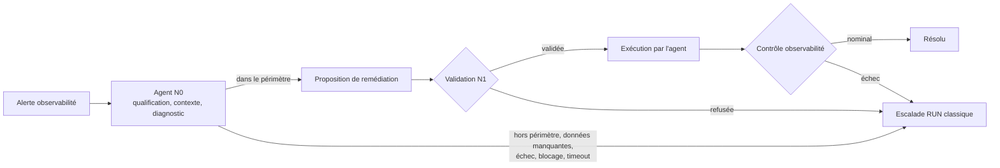

# IA4Ops — Cadrage du démonstrateur : agent N0 dans le processus RUN

> **Statut** : cadrage issu d'une réunion de travail, à valider (slides de validation à produire).
> **Source** : synthèse de réunion remise le 26 octobre 2026 (date exacte de la réunion et liste des
> participants non précisées dans la source).
> **Dernière mise à jour** : 30 octobre 2026 (section 15 : pistes de scénario à valider avec Fabian).
> **Portée** : vision, positionnement RUN, périmètre fonctionnel, garde-fous et scénario de
> démonstration. Ce document ne décrit pas l'implémentation : voir `ia4ops-progress.md` pour l'état réel.

## Lecture des statuts

Chaque élément porte le statut qu'il avait à l'issue de la réunion. Rien n'est définitif hors **ACTÉ**.

| Statut | Signification |
| --- | --- |
| **ACTÉ** | Décision prise en réunion ; sert de référence tant qu'elle n'est pas révisée |
| **PROPOSÉ** | Option privilégiée ou vision, non validée ; peut être challengée |
| **À CONFIRMER** | Hypothèse ou point technique à vérifier avant de s'appuyer dessus |
| **ÉCARTÉ** / **REMIS EN QUESTION** | Option abandonnée, ou fragilisée avec une alternative proposée |

Les sections 13 à 15 ne viennent pas de la réunion : elles confrontent le cadrage à l'existant du
dépôt (analyse du 26 octobre 2026) et signalent les écarts sans les trancher.

---

## 1. Synthèse

- **ACTÉ** : l'agent est une couche **N0** placée avant le N1. Il reçoit l'alerte, pré-analyse,
  propose une remédiation, l'exécute **après validation humaine** et termine toujours par
  **résolution ou escalade**. L'organisation N1/N2/N3 est conservée.
- **ACTÉ** : l'agent ne clôt jamais lui-même une alarme ; la résolution est constatée par
  l'observabilité.
- **PROPOSÉ (à challenger)** : scénario d'incident d'infrastructure — synchronisation GitOps
  suspendue puis ressource supprimée.
- **ÉCARTÉ** : incident simulé par feature flag OpenTelemetry Demo ; modification du code applicatif.
- **Changement de périmètre** : le cadrage fait entrer dans le démonstrateur une exécution supervisée
  de remédiation, alors que l'existant est en lecture seule (voir section 13).

---

## 2. Vision du démonstrateur

**ACTÉ**

- Réduire la sollicitation du support RUN N1 en automatisant le traitement des incidents simples.
- Objectifs cités : réduire les coûts de gestion des incidents simples, diminuer le MTTR, accélérer
  le traitement sans dégrader le processus existant.
- L'agent est un niveau **N0** inséré avant le N1. Rôle attendu : recevoir une alerte, réaliser une
  pré-analyse, proposer une résolution, éventuellement exécuter une action validée par un humain,
  escalader si nécessaire.
- Le modèle cible conserve N1, N2 et N3 : l'agent ajoute une couche d'automatisation en amont, il ne
  remplace pas l'organisation RUN.

**PROPOSÉ / VISION FUTURE**

- Une automatisation avec moins d'intervention humaine est évoquée à terme. Elle n'est **pas**
  retenue pour le démonstrateur actuel.

---

## 3. Positionnement dans le processus RUN

| Niveau | Rôle |
| --- | --- |
| **N0 (agent, nouveau)** | Analyse automatisée et proposition de résolution, exécution après validation |
| **N1** | Première ligne : reçoit alertes et incidents, premier diagnostic, applique les procédures et fiches réflexes, résout les incidents simples, escalade |
| **N2 / N3** | Expertise avancée ; plus l'escalade monte, plus le MTTR augmente (expertise et contexte à mobiliser) |

**ACTÉ** — flux cible :

---

## 4. Périmètre fonctionnel

**ACTÉ** — l'agent doit :

1. recevoir une alerte incident ;
2. qualifier l'incident ;
3. collecter du contexte ;
4. produire un diagnostic ;
5. déterminer s'il est dans son périmètre d'action ;
6. construire une proposition de remédiation ;
7. soumettre cette proposition à validation ;
8. exécuter l'action autorisée ;
9. vérifier le résultat ;
10. conclure par une résolution ou une escalade.

**ACTÉ** — l'agent ne doit pas :

- modifier le processus RUN existant ;
- rester bloqué dans un état intermédiaire sans résolution ni escalade ;
- marquer lui-même une alarme comme résolue (responsabilité des outils d'observabilité) ;
- effectuer une résolution totalement autonome et non supervisée dans le démonstrateur.

**ACTÉ** — à la charge de l'humain : valider la remédiation proposée, superviser l'exécution, prendre
en charge les escalades.

**ACTÉ** — hors périmètre immédiat : analyse du code applicatif, modification applicative complexe,
résolution autonome de bout en bout, automatisation avancée des escalades et des retries.

---

## 5. Escalade et garde-fous

**ACTÉ** — conditions d'escalade :

- l'agent ne dispose pas des éléments nécessaires ;
- l'analyse échoue ;
- la résolution n'aboutit pas ;
- le temps maximal autorisé est dépassé (exemple évoqué : **5 minutes**, valeur non arrêtée) ;
- l'agent est bloqué.

**ACTÉ** — garde-fous :

- human-in-the-loop : validation humaine avant toute action ;
- timeout d'analyse et de résolution ;
- retour automatique au processus RUN classique en cas d'échec ;
- état terminal obligatoire : **résolu** ou **escaladé** ;
- conservation du modèle N1/N2/N3 ;
- contrôle final par le système d'observabilité.

**À CONFIRMER**

- retry automatique avant escalade, ou escalade immédiate ;
- critères exacts de bascule vers l'escalade (dont la valeur du timeout) ;
- niveau d'autonomie visé dans les itérations futures.

---

## 6. Scénario de démonstration

**PROPOSÉ — scénario privilégié en fin de réunion, à challenger** (voir section 14).

| Étape | Contenu |
| --- | --- |
| Situation initiale | Cluster Kubernetes fonctionnel, supervision en place, dépôt d'infrastructure accessible |
| Génération de l'incident | 1. un opérateur met en pause la synchronisation du cluster ; 2. une ressource est supprimée ; 3. le cluster ne peut plus la recréer automatiquement ; 4. une alerte est générée |
| Symptômes | Ressource absente, cluster désynchronisé, incident remonté par l'observabilité |
| Informations accessibles | État du cluster, informations Kubernetes, dépôt d'infrastructure, logs, données d'observabilité, historique des modifications d'infrastructure |
| Investigation attendue | Lecture de l'alerte → éléments du cluster → logs et observabilité → référentiel d'infrastructure → recherche d'une divergence entre état attendu et état réel |
| Diagnostic attendu | Cluster désynchronisé, ressource absente, incohérence entre état déployé et état attendu |
| Cause racine attendue | Erreur opérateur : synchronisation interrompue puis ressource supprimée |
| Remédiation attendue | Resynchronisation ; éventuellement rollback ou restauration de la configuration attendue |
| Rôle humain | Validation de la proposition et autorisation d'exécution (N1) |
| Exécution | L'agent applique la remédiation après validation N1 |
| Contrôle | Retour à l'état nominal vérifié par l'observabilité |
| État final | Incident résolu, ou escalade vers un opérateur |

Chaîne fonctionnelle reconstituée :

> Erreur opérateur → désynchronisation du cluster → suppression de ressource → alerte observabilité
> → agent N0 → collecte du contexte (cluster, logs, observabilité, dépôt infra) → diagnostic →
> proposition de résolution → validation N1 → exécution → vérification observabilité → résolution
> OU escalade.

---

## 7. Sources d'information et outils

| Source | Usage prévu |
| --- | --- |
| Kubernetes | Inspection de l'état des ressources, détection d'objets manquants, vérification de la synchronisation |
| Dépôt Git d'infrastructure | Configuration attendue, changements récents, proposition de rollback ou de correction |
| Observabilité | Détection des alertes, confirmation de la résolution, contexte |
| Logs | Compréhension de l'origine de l'incident pendant le diagnostic |
| Grafana | Source potentielle consultée lors du diagnostic |

---

## 8. Décisions prises

| Décision (ACTÉ) | Justification | Impact |
| --- | --- | --- |
| Agent positionné comme N0 | Automatiser sans casser l'organisation existante | Architecture globale du démonstrateur |
| Human-in-the-loop conservé | Éviter une résolution totalement autonome | Validation humaine obligatoire avant action |
| Fin obligatoire par résolution ou escalade | Éviter les incidents abandonnés | Mécanisme de surveillance, de timeout et d'escalade à prévoir |
| L'agent ne clôt pas lui-même les alarmes | Responsabilité laissée à l'observabilité | Séparation claire des responsabilités |

---

## 9. Hypothèses à confirmer

**À CONFIRMER**

- l'agent dispose des accès Kubernetes nécessaires ;
- l'agent peut accéder au dépôt d'infrastructure ;
- la liaison cluster ↔ dépôt peut reposer sur des labels Kubernetes ;
- le scénario de désynchronisation est techniquement réalisable tel qu'imaginé ;
- les capacités de lecture des données Kubernetes sont validées (avant la démonstration).

---

## 10. Idées écartées ou remises en question

| Statut | Idée | Problème | Alternative |
| --- | --- | --- | --- |
| **ÉCARTÉ** | Incident basé sur un feature flag OpenTelemetry Demo | Faux incident, sans véritable logique de résolution | Incident d'infrastructure réel |
| **ÉCARTÉ** | Modification du code applicatif | Trop de travail, perte de maîtrise, dépendance au build applicatif | Agir au niveau infrastructure |
| **REMIS EN QUESTION** | Suppression simple d'un pod | Kubernetes corrige seul ; valeur de l'agent peu démontrée | Désynchronisation + suppression de ressource |

---

## 11. Trajectoire d'évolution

- **Version minimale** : analyse d'incident, diagnostic, proposition de remédiation, validation
  humaine, démonstration d'une action corrective.
- **Évolutions envisagées (PROPOSÉ)** : contexte enrichi, couplage plus fort avec Kubernetes et le
  dépôt d'infrastructure, automatisation accrue des remédiations, traitement post-mortem,
  diminution progressive de l'intervention humaine.
- **Logique d'itération** : incrémentale ; enrichir l'analyse avant de viser plus d'automatisation.

---

## 12. Actions et questions ouvertes

| Action | Responsable | Résultat attendu | État au 26/10 |
| --- | --- | --- | --- |
| Slides : intégration de l'agent et scénario de démonstration | Maël Mitchel | Support de validation du concept | 🔄 version 1 produite le 26/10 (21 slides, charte Wavestone, hors dépôt) |
| Partager puis faire valider les slides | Maël Mitchel et équipe | Cadrage validé | ⏳ |
| Plan de réalisation du cas d'usage | Maël Mitchel | Étapes d'implémentation | ⏳ |
| Vérifier l'accès de l'agent au cluster Kubernetes | Équipe projet | Validation technique | 🔄 lecture seule sur `otel-demo` déployée (rollout confirmé le 30/10) ; diagnostic réel citant `kubernetes` non vérifié |
| Vérifier l'accès au dépôt d'infrastructure | Équipe projet | Validation technique | ⏳ aucun accès implémenté |
| Tester la lecture des données Kubernetes avant la démonstration | Équipe projet | Réduction du risque de démo | ⏳ |

Questions ouvertes issues de la réunion :

- Quel incident est le plus pertinent pour la démonstration finale ?
- Comment exposer proprement le dépôt d'infrastructure à l'agent ?
- Le mécanisme de label Kubernetes suffit-il pour relier les ressources au dépôt ?
- Retries ou escalade immédiate après échec ?
- Quels droits de remédiation peuvent être accordés à l'agent ?
- Quel niveau d'autonomie viser dans les itérations futures ?

---

## 13. Écarts avec l'existant (analyse du 26 octobre 2026)

Comparaison entre le cadrage et le dépôt `poc-ai4ops` (`origin/main`, `863e529`). États en cluster
non vérifiés.

| Sujet | Cadrage | Existant | Conséquence |
| --- | --- | --- | --- |
| Remédiation | Exécution après validation N1 dans le démonstrateur (**ACTÉ**) | Lecture seule par construction, `action_executed` toujours `False` ; plans : remédiation « hors périmètre », après fiabilisation du diagnostic | Révision du principe *Least Agency* : catalogue d'actions, droits d'écriture minimaux, simulation, audit, rollback à concevoir |
| Validation humaine | Validation N1 de la remédiation | Chatbot : « Investiguer / Ignorer » valide le lancement d'une **investigation**, pas une action ; Keep : lecture du diagnostic | Canal de validation N1 à choisir (chatbot, Keep, autre) |
| Escalade et timeout | État terminal obligatoire, timeout (ex. 5 min), retour au RUN | Aucun état « escaladé » ni timeout global ; le workflow s'arrête au rapport ; incidents Keep laissés ouverts | Machine à états d'incident et mécanisme d'escalade à concevoir |
| Clôture des alarmes | Jamais par l'agent | Sur `resolved`, l'agent ajoute une activité Keep sans clôture | **Cohérent** |
| Scénario | Incident d'infrastructure GitOps (**PROPOSÉ**) ; feature flag **ÉCARTÉ** | Règles d'alerte, catalogue d'actions du contrat webhook et tests orientés feature flags OTel Demo | Les flags restent utiles pour tester le diagnostic, plus comme scénario de démo ; règle d'alerte du nouveau scénario à créer |
| Kubernetes | État, objets manquants, synchronisation | `get`/`list` sur `pods`, `events`, `deployments`, `replicasets` dans `otel-demo` uniquement | Aucun accès aux objets Flux (`Kustomization` dans `flux-system`, `HelmRelease` dans `otel-demo`) |
| Dépôt d'infrastructure et historique | Configuration attendue, changements récents | Non implémenté (source « derniers déploiements Flux / Git » prévue au contrat webhook, jamais réalisée) | Nouveau provider à concevoir (lecture du dépôt public, état Flux) |
| Observabilité, logs, Grafana | Contexte et confirmation de résolution | Prometheus, Loki, Jaeger via proxy Grafana, statut par source | Réutilisable ; la « vérification du résultat » par l'agent n'existe pas |

---

## 14. Points à challenger sur le scénario privilégié (analyse du 26 octobre 2026)

Éléments tirés de la configuration du dépôt, à vérifier en cluster. Ils ne remettent pas en cause
le choix d'un incident d'infrastructure, mais conditionnent sa faisabilité (hypothèse « scénario
réalisable tel qu'imaginé »).

1. **Deux mécanismes de synchronisation distincts.** Les workloads OTel Demo sont installés par une
   `HelmRelease` (`manifest/applications/otel-demo/otel-demo-helmrelease.yaml`) sans
   `driftDetection`. D'après la [documentation Flux](https://fluxcd.io/flux/components/helm/helmreleases/#drift-detection),
   la détection de dérive est désactivée par défaut : un Deployment du chart supprimé ne serait
   **pas** recréé, même sans suspension, et la `HelmRelease` resterait `Ready`. À l'inverse, les
   ressources posées directement par la Kustomization `otel-demo` (Ingress, Middleware,
   PrometheusRule, Namespace) sont réappliquées toutes les 10 minutes tant qu'elle n'est pas
   suspendue. Le choix de la ressource supprimée détermine donc s'il faut suspendre, ce qui est
   observable et quelle remédiation convient (`flux resume`, réconciliation forcée de la release,
   restauration depuis Git).
2. **Détection.** Aucune métrique ni règle d'alerte ne porte aujourd'hui sur l'état Flux (pas de
   PodMonitor/ServiceMonitor Flux ni de `customResourceState` kube-state-metrics dans les manifests).
   L'alerte viendrait d'un effet indirect : taux d'erreur des appelants si un service est supprimé,
   ou règle existante `OtelDemoFrontendNoTraffic` (aucun trafic frontend pendant 5 min) si le
   frontend, le frontend-proxy ou le load-generator disparaît. L'alerte ne porte donc pas la cause,
   que l'agent doit retrouver. Certaines suppressions ne déclencheraient aucune alerte (ex. PrometheusRule).
3. **Liaison cluster ↔ dépôt par labels.** Flux pose des labels de propriété sur les objets qu'il
   applique (`kustomize.toolkit.fluxcd.io/name`, `helm.toolkit.fluxcd.io/name`), mais une ressource
   **supprimée** n'a plus de labels à lire. Il faut comparer l'état attendu (dépôt ou manifeste de la
   release) à l'état réel.
4. **Droits de remédiation.** Diagnostiquer demande au minimum la lecture des objets Flux. Remédier
   demande des droits d'écriture (`patch` sur `Kustomization`/`HelmRelease`, ou création de la
   ressource). Une alternative est une correction par commit/PR sur le dépôt, Flux restant seul à
   écrire dans le cluster. Le dépôt étant public et lu depuis `main`, ce choix est à arbitrer.
5. **Budget de 5 minutes.** Un diagnostic Gemini a déjà été mesuré à 205 s (timeout LLM 120 s par
   appel). Il faut ajouter l'attente de validation N1, l'exécution, puis la vérification : les règles
   d'alerte ont des `for:` de 2 à 5 minutes et calculent des taux sur 5 minutes, donc la notification
   `resolved` arrive plusieurs minutes après le retour au nominal. Il faut préciser ce que couvre le
   timeout (avant validation humaine, ou bout en bout) et comment l'observabilité confirme le retour
   au nominal dans ce délai.
6. **Reproductibilité.** Déclenchement et nettoyage automatisés du scénario, avec cause attendue,
   rejoignent le besoin déjà identifié de scénarios d'incident mesurables.

---

## 15. Pistes pour fiabiliser le scénario (analyse du 30 octobre 2026)

**PROPOSÉ — à valider avec Fabian** (plateforme). Rien n'est décidé ni implémenté ; vérifications en
cluster à faire avant tout engagement.

### Piste A (privilégiée) : suspension Flux rendue cohérente

- **Prérequis plateforme** : activer `spec.driftDetection` sur la `HelmRelease` `otel-demo`, d'abord
  en `warn` (repérer les fausses dérives, ajouter des règles `ignore`), puis en `enabled`. Sans cela,
  un Deployment supprimé n'est jamais recréé et `flux resume` ne répare rien.
- **Incident** : suspendre la `HelmRelease`, supprimer le Deployment `product-catalog` (le Service
  reste). Récit : un opérateur suspend Flux pour un correctif manuel, supprime le Deployment pour le
  recréer, puis est interrompu.
- **Détection** : alerte existante `OtelDemoServiceHighErrorRate` sur les appelants (frontend,
  checkout, recommendation) ; l'alerte porte le symptôme, pas la cause.
- **Diagnostic** : Service sans endpoint + Deployment absent + `HelmRelease.spec.suspend=true` +
  aucun commit récent. Cause « erreur opérateur » présentée comme probable.
- **Remédiation après validation N1** : lever la suspension et demander une réconciliation ; seul droit
  d'écriture : `patch` sur `helmreleases`, `resourceNames: [otel-demo]`.
- **Vérification par l'agent** : Deployment prêt, endpoints revenus, taux d'erreur sur 1 min ; ne pas
  attendre la notification `resolved` (5 à 10 min après correction). L'alarme se clôt seule.
- **Reproductibilité** : cibles Makefile de déclenchement et de nettoyage.
- **Lectures supplémentaires** : `helmreleases` (`otel-demo`), `kustomizations` (`flux-system`),
  `services` et `endpointslices` (`otel-demo`).

### Piste B (second scénario possible) : changement défectueux poussé dans Git

- Un commit dégrade les values de la `HelmRelease` (ex. limite mémoire trop basse) → OOMKill →
  alerte existante `OtelDemoContainerOOMKilled`.
- L'agent rapproche l'alerte du commit récent, puis propose une PR de revert ; le merge vaut
  validation N1 et Flux applique. L'agent n'écrit jamais dans le cluster.
- Freins : token GitHub et protection de `main` obligatoires (Flux étant cluster-admin, un token
  capable de merger équivaut à un accès admin) ; injection par commit sur le `main` public partagé.

### À vérifier ou trancher

- Accord de Fabian sur `driftDetection` et sur l'extension du RBAC de lecture.
- Spans du frontend bien en erreur quand `product-catalog` est absent.
- Fausses dérives de la `HelmRelease` en mode `warn`.
- Traitement par l'agent d'une notification groupant plusieurs alertes (frontend, checkout…).
- Périmètre du timeout de 5 min : proposition de le limiter à la phase agent (diagnostic et
  proposition), hors attente humaine et confirmation par l'alerte.

---

## Glossaire

- **N0** : couche automatisée proposée, avant le N1, chargée de l'analyse et de la proposition de
  résolutions.
- **N1** : premier niveau de support (qualification, diagnostic simple, procédures standard).
- **N2 / N3** : niveaux d'expertise supérieurs sollicités pour les incidents complexes.
- **Fiche réflexe** : procédure standard pour résoudre un incident connu.
- **MTTR** : temps de résolution d'un incident ; objectif d'amélioration explicite.
- **Human-in-the-loop** : l'humain valide la remédiation proposée avant exécution.
- **Rollback** : retour à un état de configuration antérieur.
- **Synchronisation du cluster** : alignement de l'état réel sur l'état attendu décrit dans le
  référentiel d'infrastructure (ici, FluxCD depuis `main`).
