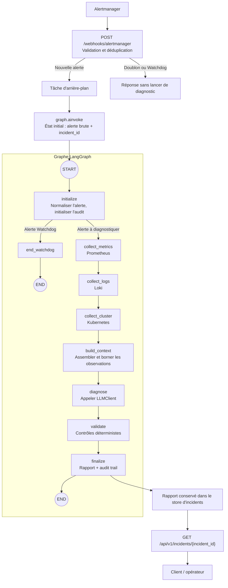
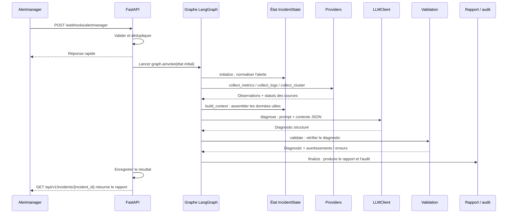

# Architecture LangGraph de l'agent IA4Ops

Ce document donne une vue d'ensemble du parcours d'une alerte dans l'agent IA4Ops : de sa réception jusqu'au rapport de diagnostic. Il décrit le fonctionnement tel qu'il est implémenté dans `poc-ai4ops/ia4ops-agent`.

## L'idée en une phrase

**LangGraph orchestre un workflow : le code choisit les étapes et leur ordre, tandis que le LLM intervient à l'étape `diagnose` pour interpréter les données et produire un diagnostic structuré.**

Ce n'est pas un agent libre qui choisit lui-même des outils ou le prochain nœud. Les collectes et le routage sont définis dans le code.

## Vue globale du traitement

Les appels de collecte sont **séquentiels** dans ce graphe. Une source indisponible ou partielle est notée dans l'état, mais ne bloque pas les étapes suivantes.

## Les briques du graphe

### 1. Le point d'entrée et le lancement

La route webhook reçoit et valide l'alerte Alertmanager, élimine les doublons puis programme l'exécution du graphe en arrière-plan. Le traitement commence par `graph.ainvoke(...)`, auquel la route transmet l'alerte brute et l'identifiant d'incident.

- Réception et lancement : [`routes.py`](../ia4ops-agent/src/ia4ops_agent/api/routes.py)
- Création du graphe et choix des dépendances au démarrage : [`main.py`](../ia4ops-agent/src/ia4ops_agent/main.py)

### 2. Le graphe : nœuds et arêtes

Le graphe est construit dans [`builder.py`](../ia4ops-agent/src/ia4ops_agent/graph/builder.py).

- Un **nœud** est une fonction qui réalise une étape et renvoie les champs d'état qu'elle met à jour.
- Une **arête** indique quelle étape vient ensuite.
- Une **arête conditionnelle** appelle une fonction de routage qui sélectionne la prochaine étape.
- `START` et `END` marquent l'entrée et les sorties du graphe.

Le nœud terminal `end_watchdog` arrête le workflow lorsqu'une alerte Watchdog est détectée.

### 3. L'état partagé : le dossier de l'incident

`IncidentState`, défini dans [`state.py`](../ia4ops-agent/src/ia4ops_agent/graph/state.py), est le contexte commun transmis d'un nœud à l'autre. Il contient notamment :

| Groupe de données | Exemples de champs |
| --- | --- |
| Identification et alerte | `incident_id`, `correlation_id`, `raw_alert`, `normalized_alert` |
| Données collectées | `metrics_data`, `logs_data`, `cluster_data` |
| Disponibilité des sources | `metrics_status`, `logs_status`, `cluster_status` |
| Analyse | `incident_context`, `diagnosis` |
| Suivi | `warnings`, `errors`, `missing_information`, `audit_events` |
| Résultat | `report` |

Chaque nœud lit les informations nécessaires et renvoie ses mises à jour. LangGraph les rend disponibles aux étapes suivantes.

### 4. Les nœuds de collecte et de préparation

1. **`initialize`** analyse l'alerte, produit une forme normalisée et initialise les métadonnées d'incident.
2. **`collect_metrics`** demande les métriques du service au provider configuré.
3. **`collect_logs`** récupère les logs d'erreur.
4. **`collect_cluster`** récupère l'état du workload et ses événements Kubernetes.
5. **`build_context`** transforme les données en observations compactes, limite leur volume et ajoute les statuts des sources.

Le contexte compact préparé par `build_context` est celui qui sera envoyé au modèle ; il évite de lui transmettre des volumes bruts.

### 5. Le LLM : analyse au nœud `diagnose`

Le nœud [`diagnose.py`](../ia4ops-agent/src/ia4ops_agent/graph/nodes/diagnose.py) appelle l'interface `LLMClient`. Cette étape est le moment où le modèle **interprète** les observations et propose une hypothèse, un niveau de sévérité, des preuves et des vérifications recommandées.

Les prompts se trouvent dans [`prompts.py`](../ia4ops-agent/src/ia4ops_agent/llm/prompts.py) :

- `SYSTEM_PROMPT` fixe le rôle SRE, les règles de prudence et le fonctionnement en lecture seule.
- `build_user_message(...)` insère le contexte d'incident au format JSON.
- `PROMPT_VERSION` identifie la version de ces instructions.

Le client Gemini assemble un message système et un message utilisateur, puis demande une réponse structurée dans [`client.py`](../ia4ops-agent/src/ia4ops_agent/llm/client.py). La forme attendue est décrite par `DiagnosticOutput` dans [`diagnosis.py`](../ia4ops-agent/src/ia4ops_agent/domain/diagnosis.py).

L'implémentation sélectionne `FakeLLMClient` par défaut ; `GeminiVertexClient` est sélectionné lorsque `LLM_PROVIDER=gemini`. Le graphe utilise l'interface `LLMClient`, ce qui permet de remplacer le fournisseur sans modifier ses nœuds.

### 6. Validation et finalisation

- **`validate`** effectue des contrôles par le code sur la structure du diagnostic, les preuves référencées et les règles de lecture seule. Cette étape ne demande pas au LLM de « revérifier » son propre résultat.
- **`finalize`** assemble le rapport, ajoute les statuts des sources et écrit les événements d'audit.
- Le rapport final marque `action_executed` à `false`. Le LLM peut **suggérer** une vérification ou une remédiation, mais le workflow ne l'exécute pas.

## Qui décide de quoi ?

| Question | Qui décide ? | Exemple dans ce projet |
| --- | --- | --- |
| Quelle étape vient ensuite ? | Le graphe et ses fonctions de routage en Python | Après `initialize`, Watchdog va à `end_watchdog`, sinon le graphe collecte les données |
| Faut-il continuer si une source manque ? | Le code du workflow | Oui : les étapes suivantes continuent et la source est marquée comme indisponible |
| Quelle cause est la plus plausible ? | Le LLM au nœud `diagnose` | Il formule une hypothèse à partir du contexte fourni |
| La sortie respecte-t-elle les contraintes ? | Le code, après le LLM | `validate` applique les contrôles et relève les violations |
| Faut-il exécuter une remédiation ? | Personne dans ce workflow | Les remédiations sont informatives ; aucune action n'est exécutée |

Le routage conditionnel est défini dans [`routing.py`](../ia4ops-agent/src/ia4ops_agent/graph/routing.py). Dans la version actuelle, le seul choix de chemin qui change le parcours nominal est l'arrêt anticipé des alertes Watchdog. Les collectes continuent vers `build_context` même lorsque les données sont partielles ou indisponibles.

## Cycle d'une exécution

## Parcours de lecture du code

Pour comprendre la mise en œuvre, lire dans cet ordre :

1. [`main.py`](../ia4ops-agent/src/ia4ops_agent/main.py) — sélection des providers et du client LLM, puis construction du graphe.
2. [`routes.py`](../ia4ops-agent/src/ia4ops_agent/api/routes.py) — réception du webhook et appel du graphe.
3. [`builder.py`](../ia4ops-agent/src/ia4ops_agent/graph/builder.py) — nœuds et connexions du workflow.
4. [`state.py`](../ia4ops-agent/src/ia4ops_agent/graph/state.py) — données partagées entre les nœuds.
5. [`routing.py`](../ia4ops-agent/src/ia4ops_agent/graph/routing.py) — décisions de parcours.
6. [`build_context.py`](../ia4ops-agent/src/ia4ops_agent/graph/nodes/build_context.py), puis [`prompts.py`](../ia4ops-agent/src/ia4ops_agent/llm/prompts.py) et [`client.py`](../ia4ops-agent/src/ia4ops_agent/llm/client.py) — préparation et appel au LLM.
7. [`validate.py`](../ia4ops-agent/src/ia4ops_agent/graph/nodes/validate.py) et [`finalize.py`](../ia4ops-agent/src/ia4ops_agent/graph/nodes/finalize.py) — contrôles et sortie finale.
